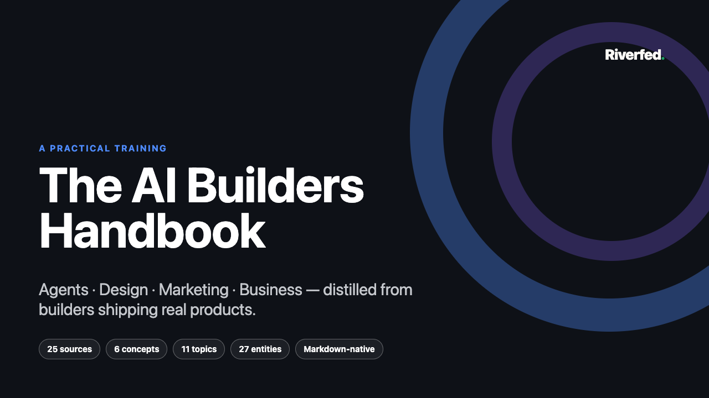
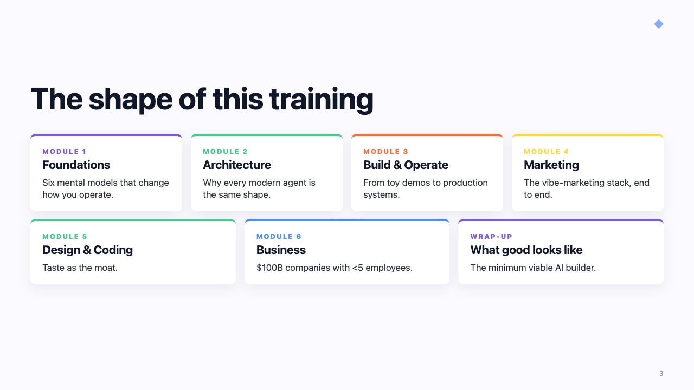
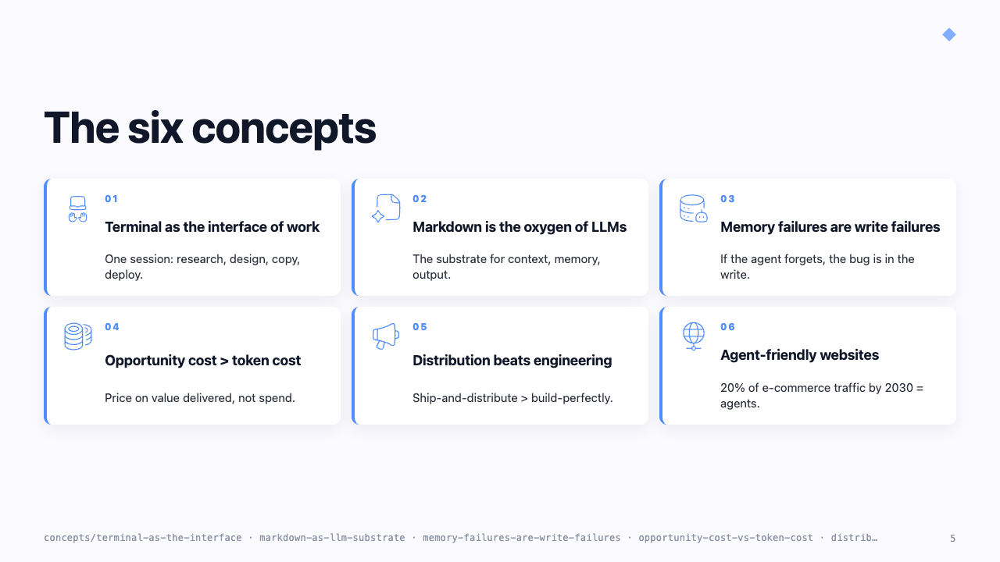
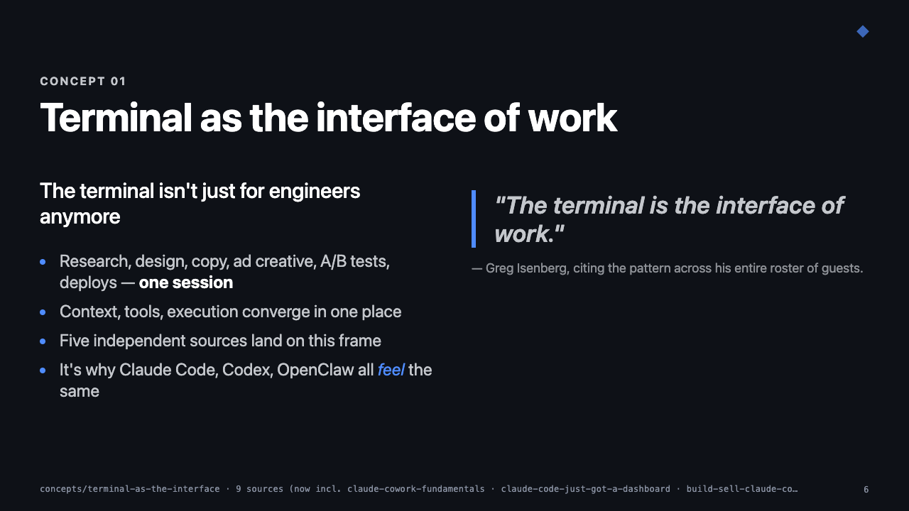
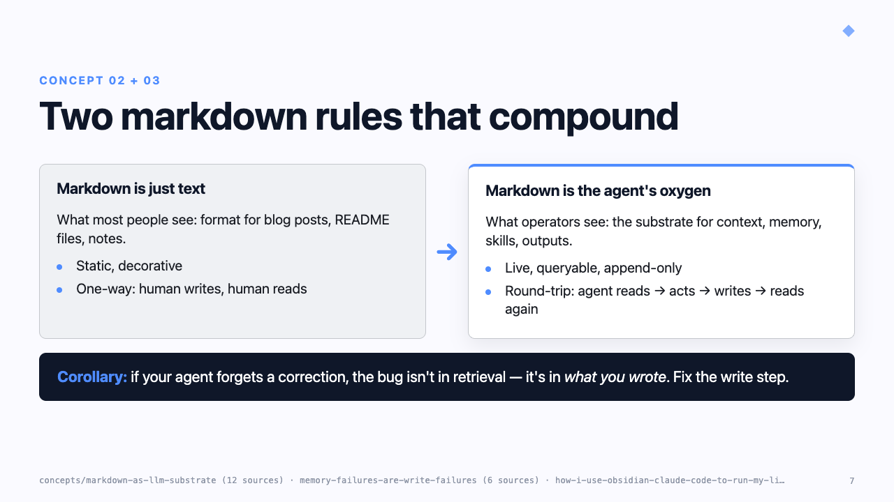
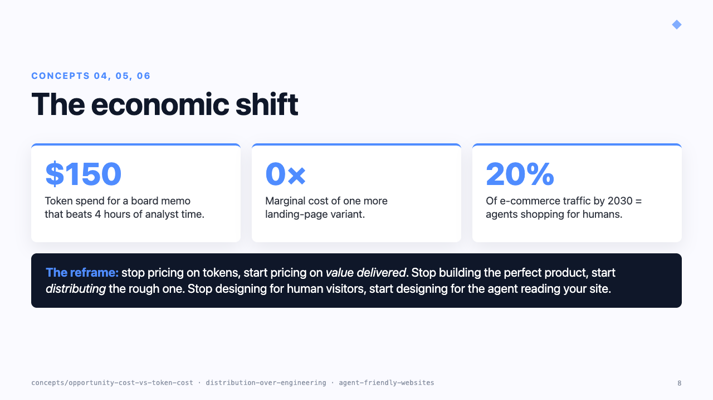

<h1 align="center">Riverfed</h1>

<p align="center">
  <em>An automated knowledge base that turns any file or video into a wiki —
  then turns the wiki into training material.</em>
</p>

---

## What this is

Four coherent surfaces sharing one brand:

| Surface | Route | What it does |
|---|---|---|
| **Converter UI** | `http://127.0.0.1:8765/` | Drop a file or paste a YouTube URL → clean markdown in `output/`; create knowledge bases (pick a **knowledge model**); **watch YouTube channels** so new uploads land by themselves |
| **Studio** | `http://127.0.0.1:8765/studio` | Pick a base + a design + generate a Marp deck, **native editable PPTX**, Excalidraw diagram, **Anki flashcard deck**, or an **agent skill library** (Claude Code skills + `AGENTS.md`) |
| **Wiki** | `http://127.0.0.1:8765/wiki` | LLM-curated knowledge bases + Obsidian-style graph (model-aware: karpathy wiki, PARA, SOPs) |
| **Landing page** | `http://127.0.0.1:8765/about` | Marketing intro for Riverfed |

The converter is the on-ramp. The knowledge bases are the substrate —
each one follows a **knowledge model** (`models/`): the original
Karpathy-style teach-back wiki, a **Second Brain (PARA)** organized for
action, or **SOPs-to-Skills** for a business's operational docs. The
Studio runs generators on top: Marp deck, native editable PPTX (13 slide
types), Excalidraw diagram, Anki deck (spaced repetition from your own
wiki), and the skills compiler — knowledge in, an executable
`.claude/skills/` library (+ `AGENTS.md`) out. Every agent step —
ingest, review, all generators — runs on the CLI you already pay for:
**Claude Code** (default), **Grok** or **Codex**, switchable from the **Agent**
selector on `/`. Decks and diagrams pick up the design
system you select (Riverfed / Heritage / Aurora, or your own).

And it compounds on its own: subscribe a base to YouTube channels and
the **watcher** converts new uploads while you sleep (queue-for-approval
by default; flip a channel to auto-ingest for fully unattended growth).
Caption-less videos transcribe locally through whisper.cpp with no API key.
Groq remains an optional final fallback only when `GROQ_API_KEY` is configured.

**See [`CHANGELOG.md`](CHANGELOG.md)** for what's new since your last sync —
knowledge models + picker, PARA + SOPs templates, the skills compiler with
an executed-skill pilot, the channel watcher, Anki decks, bring your own
agent (Claude Code, Grok or Codex), CI.

**Contributing?** [`CONTRIBUTING.md`](CONTRIBUTING.md) is the human
workflow (fresh-machine setup, `sync.cmd`/`ship.cmd` daily flow, commit
conventions, testing); [`CLAUDE.md`](CLAUDE.md) is the technical
orientation for AI-agent sessions. Both are kept current — start there.

## What the output looks like

A peek at the AI Builders Handbook — the 30-slide deck generated from the wiki.
Each slide uses components from the shared design system
([`wiki/training/design.md`](wiki/training/design.md)).

<table>
  <tr>
    <td width="50%">
      
      <p align="center"><em>Cover — Riverfed wordmark, title, and live wiki counts</em></p>
    </td>
    <td width="50%">
      
      <p align="center"><em>Module cards — the Jedi color palette in action</em></p>
    </td>
  </tr>
  <tr>
    <td width="50%">
      
      <p align="center"><em><code>.six-up.iconic</code> grid — six concepts at a glance</em></p>
    </td>
    <td width="50%">
      
      <p align="center"><em>Dark slide variant — bullets + pull quote</em></p>
    </td>
  </tr>
  <tr>
    <td width="50%">
      
      <p align="center"><em><code>.versus</code> panels + <code>.callout</code> — old vs new</em></p>
    </td>
    <td width="50%">
      
      <p align="center"><em><code>.kpi</code> block — quantitative emphasis</em></p>
    </td>
  </tr>
</table>

Full deck: [PDF](wiki/training/out/ai-builders-handbook.pdf) ·
[PPTX](wiki/training/out/ai-builders-handbook.pptx) ·
[HTML](wiki/training/out/ai-builders-handbook.html) ·
[Speaker notes (DOCX)](wiki/training/out/ai-builders-handbook-speaker-notes.docx) ·
[Markdown source](wiki/training/ai-builders-handbook.md)

## How conversion works

YouTube URLs go through [yt-dlp](https://github.com/yt-dlp/yt-dlp) for robust
caption extraction. Office documents (DOCX, PPTX, XLSX, ODT, RTF, EPUB and
their variants) convert through Firecrawl's
[anydoc](https://github.com/firecrawl/anydoc) — a local Rust parser that
preserves slide reading order and heading structure — with Microsoft's
[markitdown](https://github.com/microsoft/markitdown) as the automatic
fallback (`--converter` picks the engine explicitly; empirical A/B in
[`docs/anydoc-comparison.md`](docs/anydoc-comparison.md)). Everything else
(PDF, audio, images, HTML, etc.) goes through markitdown. Output is a `.md` file
with YAML frontmatter, ready to hand to Claude Code or any other
markdown-aware agent.

Two entry points:

- **Web UI** — drag-and-drop at `http://127.0.0.1:8765`
- **CLI** — `convert.cmd <url-or-file>` from any shell

## One-time setup

On a Mac, the idempotent bootstrap creates the Python environment, installs
dependencies, copies `.env.example` when needed, installs whisper.cpp 1.9.2,
downloads the checksum-pinned 75 MiB smoke model, and runs a one-second local
transcription check:

```bash
git clone https://github.com/ipodvs/riverfed.git
cd riverfed
./setup.sh
./serve.command
```

This repository is private. Collaborators must authenticate with GitHub before
cloning; [`CONTRIBUTING.md`](CONTRIBUTING.md) has the one-time `gh auth` steps
and the separate private-vault clone commands.

The smoke model proves the offline path without a large download. For normal
captionless-video quality, explicitly install the 547 MiB multilingual model:

```bash
./setup.sh --whisper-model large-v3-turbo-q5_0 --skip-python-deps
```

Models live in the user cache outside Git. `RIVERFED_WHISPER_MODEL`,
`RIVERFED_WHISPER_DIR`, and `WHISPER_CPP_BIN` provide explicit overrides.

From `C:\Users\ipodvs\Youtuber` in PowerShell:

```powershell
py -3.13 -m venv .venv
.\.venv\Scripts\Activate.ps1
python -m pip install --upgrade pip
pip install -r requirements.txt
```

Optional — only needed if you want to convert audio files (`.mp3`, `.wav`, …):

```powershell
winget install Gyan.FFmpeg
```

### YouTube transcript recovery

Conversion follows one deterministic safety chain:

1. Every supported human-caption track, preferred language first.
2. Every supported automatic-caption track.
3. Every `json3`, `srv3`, and `vtt` representation, including one retry per
   URL.
4. Local whisper.cpp using the selected checksum-pinned model.
5. Remote Groq Whisper only when `GROQ_API_KEY` is configured.
6. A clear nonzero rejection if no complete transcript passes the shared
   producer and ingest guards.

Local transcripts retain detected language, timestamped segments, engine
version, model provenance, and a note that audio stayed on the machine.
Neither models nor downloaded audio are committed to Git.

## Web UI

The server has two launchers:

- **`start.vbs`** — recommended. Double-click it. The server runs *detached*
  (no terminal window to keep open) and the browser opens automatically. Use
  `stop.cmd` to shut it down.
- **`serve.cmd`** — terminal-visible launcher. Useful for debugging — every
  request is logged live to the window. Auto-restarts up to 5 times if the
  server crashes. Closing the window stops the server.

Either way, the page lives at `http://127.0.0.1:8765`. Paste a YouTube URL
into the field, or drop any file onto the drop zone. The resulting `.md`
lands in `output\` and is downloadable from the page.

**Knowledge base picker.** The bar at the top of the page selects which
knowledge base everything targets — conversions, the pending list,
ingest, review, and the output-folder listing are all scoped to it. The
**+ New** button scaffolds a fresh base (e.g. an *Investing* wiki fully
separate from your AI wiki) in seconds: it creates
`wikis/<slug>/{sources,topics,entities,concepts}` + a SCHEMA + starter
index, plus its own private `output/` staging so each base has an
isolated pending queue. Your selection sticks per browser.

The dot next to the page title shows server status:
- 🟢 green = server reachable
- 🔴 red = server is down (re-run `start.vbs`)

Logs are mirrored to `server.log` regardless of which launcher you use, so
crashes can be diagnosed even after the window is closed.

## CLI

```powershell
.\convert.cmd "https://www.youtube.com/watch?v=dQw4w9WgXcQ"
.\convert.cmd ".\some-doc.pdf"
.\convert.cmd "C:\path\to\slides.pptx"
```

Or call the script directly with the venv active:

```powershell
.\.venv\Scripts\Activate.ps1
python convert.py "https://youtu.be/dQw4w9WgXcQ"
```

Output lands in `C:\Users\ipodvs\Youtuber\output\` as `<slugified-title>.md`. The
script prints the absolute path of the file it wrote.

### Flags

| Flag | Purpose |
|---|---|
| `--out DIR` | Override the output directory |
| `--type {auto,url,file}` | Force input interpretation (default: `auto`) |
| `--no-frontmatter` | Skip the YAML frontmatter block |
| `--overwrite` | Replace an existing file instead of appending `-2`, `-3`, … |
| `--force` | Re-convert even if an `output/` file already covers this source |
| `--frames` | (YouTube only) Extract video frames + run OCR for on-screen text. Adds a `## Visual content` section to the `.md` and saves frames to `output/<slug>-frames/`. See **On-screen text** below. |
| `--frame-width N` | Frame width in pixels (default `512`; bump to `1024` for videos with small code or terminal text) |
| `--dense-until SECS` | Sample one frame every `--dense-interval` seconds from 0 up to this timestamp (default `0` = off). Use for whiteboard / Excalidraw videos where chapter-start frames catch the blank canvas. Auto-flags every dense frame as 🔍 vision-relevant. |
| `--dense-interval SECS` | Seconds between dense-sampled frames (default `30`). Only used with `--dense-until`. |
| `--max-frames N` | Cap on total frames extracted (default `30`). Bump to ~60 when using a dense window. |

### On-screen text (`--frames`)

Plain transcripts miss everything visual — slides, code shown on screen,
dashboards, terminal output, UI labels. The `--frames` flag closes that
gap **without per-token vision-API cost**:

1. Smart-samples ~10–30 frames per video (1 per chapter when the
   description has timestamps; uniform spacing otherwise).
2. Runs **local Tesseract OCR** on each frame — captures the on-screen
   text as inline blockquotes in the `.md`.
3. Tags text-heavy frames with 🔍 (likely slide / code / dashboard).
   Sparse frames get `·` (likely talking-head — the transcript already
   covers them).
4. Saves frames to `output/<slug>-frames/` (gitignored, ~3–6 MB per
   video).

When the wiki ingest runs against a `.md` that has a `## Visual content`
section, Claude opens the 🔍-tagged JPEGs with its Read tool and Grok
does the same through `read_file`. Codex receives those JPEGs as real
vision inputs through `codex exec --image`; `--add-dir` alone does not
send image pixels to that model. All three skip the `·` frames. Frame
downloads retry transient YouTube failures with a fresh signed media URL,
and the UI shows a warning plus **Retry visual capture** instead of
silently reporting a frame-less success. Uses your agent subscription
quota, **no API key**.

**Setup** (one-time):

```powershell
winget install UB-Mannheim.TesseractOCR     # OCR binary
pip install -r requirements.txt              # pytesseract + imageio-ffmpeg
```

Tesseract is free, open source, ~50 MB. `imageio-ffmpeg` bundles a
static ffmpeg binary, so no separate ffmpeg install is needed.

**Costs** (subscription quota):

| Step | Per video | Notes |
|---|---|---|
| Download + extract frames | ~30–60 s | Free (yt-dlp + ffmpeg) |
| OCR pass | ~5–10 s | Free (local Tesseract) |
| Ingest read of vision-relevant frames | adds ~10–15 K tokens | ~1.5× quota burn vs text-only ingest |

For talking-head podcast/interview videos the OCR pass detects sparse
text and Claude defaults to skipping the frames during ingest — so you
pay nothing extra for them. The vision cost lands only on screen-recording
/ slide / demo videos where it actually matters.

**Whiteboard / Excalidraw videos**: chapter-start frames catch the canvas
while it's still blank — by the time the speaker has drawn the diagram a
minute or two in, we'd missed it. Use the **dense window** for these:

```powershell
convert.cmd "https://youtu.be/<id>" --frames --frame-width 1024 `
  --dense-until 1200 --dense-interval 45 --max-frames 60
```

This samples a frame every 45 sec for the first 20 min and auto-flags
each one as 🔍 (the user-supplied window IS the "expect visual content
here" signal, overriding the OCR-density threshold that hand-drawn
text would normally fail).

Empirical comparison: [`docs/frames-ingest-comparison.md`](docs/frames-ingest-comparison.md)
shows a re-ingest of *Building AI Agents* surfacing 3 Excalidraw
diagrams the original transcript-only ingest had flattened into
bullets (the agent loop, the 4-component agent hub, the department
folder hierarchy).

### Duplicate detection

Before converting, the script canonicalizes the input and scans `output/`
for an existing file whose `source:` frontmatter matches:

- **YouTube** — all URL forms collapse to a single key by extracting the
  11-character video ID: `youtu.be/X`, `youtube.com/watch?v=X`,
  `m.youtube.com`, `music.youtube.com`, `?v=X&t=...`, `?v=X&list=...`,
  `/shorts/X`, `/live/X`, `/embed/X`, even malformed `youtu.be/X&t=...`.
- **Other URLs** — normalized to scheme + lowercase host + path (no
  trailing slash) + query string.
- **Files** — resolved to an absolute path.

If a match is found, the existing path is returned and stderr says
`already-converted: <filename> — use --force to re-convert.` Same logic
fires in the web UI: the page shows *"Already converted: <name>
(skipped)"* instead of saving a duplicate. Pass `--force` (CLI) or
toggle nothing in the UI to re-download.

### Frontmatter shape

```yaml
---
source: "https://www.youtube.com/watch?v=..."
type: "youtube"
converted_at: "2026-05-09T12:34:56Z"
title: "The Original Video Title"
---
```

`type` is one of: `youtube`, `url`, `pdf`, `docx`, `pptx`, `xlsx`, `csv`, `html`,
`audio`, `image`, `epub`, `json`, `xml`, `zip`, `text`, or `file`.

## Notes / gotchas

- **PowerShell ampersands.** URLs with `&list=...` must be quoted in PowerShell:
  `.\convert.cmd "https://www.youtube.com/watch?v=ID&list=PL..."`. Without
  quotes, PowerShell treats `&` as a command separator.
- **YouTube playlists.** Only single-video URLs are supported. The script warns
  if it sees `&list=` in the URL.
- **Transcript availability.** YouTube videos without captions produce a file
  with metadata but no transcript section. The script logs a warning when no
  caption track was found.
- **Audio files.** Need ffmpeg installed (see setup). Without it, audio
  conversion fails with a friendly hint.
- **Python 3.10+.** `markitdown` needs Python 3.10 or newer. The wrappers pin
  to `py -3.13` so the system default (3.7) doesn't get picked up.

## Pointing Claude Code at the output

Once a file is in `output\`, hand the path to Claude Code:

```
read C:\Users\ipodvs\Youtuber\output\my-video.md and summarize the key points
```

Or pre-load the whole folder as project context.

## The wiki

The `wiki/` folder is an **LLM-curated knowledge base** organized by
subject. It extends the [Karpathy three-layer
pattern](https://gist.github.com/karpathy/442a6bf555914893e9891c11519de94f)
with a fourth layer for cross-cutting ideas:

```
wiki/
├── sources/    one page per converted transcript        (the "what was said")
├── topics/     subject areas that group multiple sources (the "what's the field")
├── entities/   people, tools, products mentioned        (the "what's the named thing")
├── concepts/   cross-cutting ideas/patterns/stances     (the "what's the recurring idea")
├── index.md    catalog of every page with one-line summary
├── SCHEMA.md   conventions (frontmatter, link rules, slugging)
├── log.md      append-only ingest/lint operation log
└── scripts/    ingest.py, obsidian_pass.py, pending.py, ingest_prompt.md
```

**The four layers, in plain language:**

| Layer | What it is | When something belongs here | Example |
|---|---|---|---|
| **`sources/`** | One markdown summary per ingested transcript. The faithful condensation of *one* talk/article. | Always — every converted file gets a source page. | `sources/karpathys-autoresearch.md` |
| **`topics/`** | A subject area that multiple sources contribute to. Organizes the field. | When ≥2 sources speak about the same area. | `topics/agent-architecture.md` |
| **`entities/`** | A named thing (person, tool, product, project) referenced in the sources. | When a proper noun appears across sources and deserves its own page. | `entities/claude-code.md`, `entities/karpathy.md` |
| **`concepts/`** | A **recurring idea, stance, or pattern** that spans topics. Fuzzier than a topic, sharper than a tag. | When the same *frame of thinking* shows up across sources, often phrased differently each time. | `concepts/markdown-as-llm-substrate.md` ("markdown is the oxygen of LLMs") |

### Why `concepts/` exists (the non-obvious layer)

Topics organize the *field* (e.g. "agent architecture"). Entities organize
*named things* (e.g. "Claude Code"). Concepts organize **ideas** — the
recurring frames that operators keep arriving at independently. They're
the most valuable layer for synthesis because they capture *what's
true across the corpus*, not just what one person said.

A concept page collects:
- a one-line headline of the idea ("Markdown files are the oxygen of LLMs")
- a *Why it matters* paragraph
- **Evidence across sources** — pull quotes from each source that voiced
  this idea, with citations
- *Patterns/recipes* that follow from the concept

Concepts emerge bottom-up: the ingest agent surfaces them when ≥3
sources converge on the same frame. Once a concept exists, future
ingests append to it instead of restating it.

Entry point: [`wiki/index.md`](wiki/index.md). The index is the catalog —
every page with a one-line summary, designed so an agent can pick what to
read deeply. The exact frontmatter, link rules and slugging conventions
are in [`wiki/SCHEMA.md`](wiki/SCHEMA.md).

### Multiple knowledge bases

You're not limited to one wiki. The **Knowledge base** bar on the
converter page lists every base and scaffolds new ones (**+ New**) — so
an *Investing* vault can grow next to the AI vault without the two ever
mixing. New bases live at `wikis/<slug>/` with the same four-layer
shape and their own transcript staging; the ingest agent, auto-review
counter, Obsidian lint pass, and Studio generators all work per-base
(every wiki script takes `--wiki <slug>`). Each base is its own valid
Obsidian vault too — open `wikis/investing/` directly.

**The wiki is also a working Obsidian vault.** Open `wiki/` as a vault in
Obsidian and you get graph view, tag pane, backlinks, and aliases out of
the box. Internal links use `[[wikilinks]]`; every page has `tags:` in
frontmatter mirroring its topics/entities; entity pages have `aliases:` so
`[[Claude Code]]`, `[[claude code]]`, and `[[claude-code]]` all resolve to
the same page. Graph colors are pre-configured: sources, topics, entities.

The conversion is fully automated by `wiki/scripts/obsidian_pass.py` —
idempotent and safe to re-run after any new ingest.

#### Obsidian Bases (dashboards over your vault)

Each vault also gets **Obsidian Bases** — `.base` files Obsidian renders
as database-style views over page frontmatter. They come from the vault's
knowledge model, not hand-written per vault, so a view can never state a
stale rule: the templates interpolate the manifest's own `promote_after`
knobs. Tune a threshold in the Customize modal and the views follow.

What ships per model:

| Model | Bases |
|---|---|
| `karpathy-wiki` | **Promotion health** — violations, thin-entity enrichment queue (ranked by inbound links), evidence ranking, staleness · **Capture log** — what came in, when, from which channel |
| `second-brain` | **PARA dashboard** — active projects, waiting, areas, resources · **Weekly review** — stalled projects, done-but-not-archived, drifting areas |
| `sops-to-skills` | **Ops catalogue** — grouped by folder, procedures indexed by trigger · **SOP freshness** — overdue / due soon / recently reviewed |

Generated by [`wiki/scripts/base_gen.py`](wiki/scripts/base_gen.py) during
`obsidian_pass` and at vault-scaffold time. **Your edits win:** change a
view in Obsidian and the pipeline stops touching that file (tracked by a
sha256 ledger in the vault's gitignored `.state/bases.json`). Delete it,
or run `obsidian_pass.py --force-bases`, to re-adopt the model's version;
Save-As under a new name to keep both, since undeclared names are never
touched.

Bases are a **lens, never a source of truth** — they hold no knowledge,
only view config, and read the same frontmatter the `/wiki` browser route
reads. Nothing outside Obsidian parses them.

### Adding new transcripts to the wiki

The wiki grows automatically. Two ways to trigger ingest:

**Web UI (recommended).** The **Knowledge** section is a source-readiness
queue. Each staged source shows whether it is **Ready** or **Needs recovery**,
plus source type, duration, transcript word count, language, provenance, and
the exact guard failure. Retry recovery there when needed; the original
capture remains immutable and one usable revision is selected per logical
source. Click *Ingest ready* and the selected Claude Code or Codex CLI reads
each ready transcript, updates the knowledge base, refreshes `index.md`, and
appends to `log.md`.

**CLI.** Same thing from a terminal:

```powershell
py -3.13 wiki\scripts\ingest.py             # ingest every pending transcript
py -3.13 wiki\scripts\ingest.py --dry-run   # just list pending, no API calls
py -3.13 wiki\scripts\ingest.py --limit 1   # ingest only the first pending
```

Both paths run [`wiki/scripts/obsidian_pass.py`](wiki/scripts/obsidian_pass.py)
at the end to normalize wikilinks, tags, and aliases.

### One-time setup for auto-ingest

Auto-ingest runs headless on **the agent CLI you already pay for** —
**Claude Code** (default; [claude.ai](https://claude.ai/) Pro or Max),
**Grok** (a grok.com plan) or **Codex** (a ChatGPT plan). No API key
required. Inference is billed against that subscription's usage limits,
not pay-per-token.

Setup (any one is enough; install several to switch freely):

1. Claude Code: <https://claude.com/claude-code>, then
   ```powershell
   claude auth login
   ```
2. Grok: <https://grok.com/>, then
   ```powershell
   grok login
   ```
3. Codex (alternative/fallback):
   ```powershell
   npm install -g @openai/codex
   codex login
   ```
4. That's it. The server probes every CLI — the *Ingest ready*
   button activates as soon as one is logged in.

Claude Code also requires project trust. Run `claude` interactively once from
the cloned repository and accept the trust prompt before using headless
ingest. If Claude is installed but not trusted yet, explicitly choose **Grok**
or **Codex** instead of **Auto**.

The **Agent** selector on `/` (next to the Knowledge base picker)
chooses who runs the work: **Auto** (the first ready of Claude Code,
Grok, Codex) or an explicit pick — which fails with the exact login
command when that CLI isn't ready, never silently switching. The Studio
follows the same choice. CLI equivalent:
`--provider auto|claude-code|grok|codex` on ingest/promote/studio
scripts; quick status check:
`py -3.13 wiki\scripts\agent_runner.py --status`.

The web UI shows the active agent + account next to *"Wiki is up to
date"* so you can confirm at a glance.

If you want to override which binary a provider invokes (rare —
multiple installs side-by-side, or a service PATH that misses grok's
`~/.local/bin`), set `CLAUDE_BIN` / `CODEX_BIN` / `GROK_BIN` in the
environment before launching the server. Similarly, `CLAUDE_MODEL` /
`CODEX_MODEL` / `GROK_MODEL` (env var or `.env`) pin which model the
pipeline runs on: `CLAUDE_MODEL=opus` tracks the newest Opus-tier
model (keep the CLI fresh — stale alias tables resolve low), a full id
like `claude-opus-4-8` hard-pins, and unset inherits your interactive
Claude Code default (Codex: your `~/.codex/config.toml`; Grok: its own
default, currently grok-4.6).

### Manually steering an ingest (alternate path)

If you'd rather drive the ingest yourself in Claude Code (or another
agent), paste [`wiki/scripts/ingest_prompt.md`](wiki/scripts/ingest_prompt.md)
into the agent. It contains the same instructions the auto-ingest script
uses, in a self-contained prompt.

### Linting the wiki

Periodically ask Claude Code to run a lint pass — the criteria are in
[`wiki/SCHEMA.md`](wiki/SCHEMA.md) under *Linting*. Findings get logged to
`wiki/log.md`.

## Training decks (Marp + native PPTX + design system)

Once the wiki has enough content, the next layer is **content
generation** — turning structured knowledge into something teachable.
The Studio (`/studio`) runs five generators on top of the wiki:

- **Marp deck** — Markdown-to-slide; HTML/PDF/PPTX exports. Rich
  component library, great for diff-able sources. Marp's pptx export
  is a flattened image flipbook though.
- **Native editable PPTX** — sibling renderer in
  [`wiki/scripts/studio_pptx.py`](wiki/scripts/studio_pptx.py). 13
  slide types (`cover` · `lead` · `section` · `content` · `kpi` ·
  `donut-kpi` · `quote` · `versus` · `cards` · `six-up` · `flow` ·
  `timeline` · `hub`). Every slide opens in PowerPoint as real
  editable text boxes + shapes. Each slide gets the **ambient
  diamond brand mark** top-right; capped cards share rounded corners
  with their accent stripe via a hard-edge gradient.
- **Excalidraw diagram** — for system maps and flows.
- **Anki flashcard deck** —
  [`wiki/scripts/studio_anki.py`](wiki/scripts/studio_anki.py): the
  agent authors atomic, source-cited Q/A cards from the base; Python
  packages them as a real `.apkg` (import straight into Anki;
  re-generating updates the deck instead of duplicating it).
- **Claude Code skill library** —
  [`wiki/scripts/studio_skills.py`](wiki/scripts/studio_skills.py):
  compiles a base (best: a SOPs-to-Skills one) into
  `.claude/skills/<name>/SKILL.md` per procedure/runbook + a library
  README + `AGENTS.md` (loads in Claude Code *and* Codex sessions).
  Knowledge in, agents out.

The **Marp deck** and **native PPTX** generators reskin to the **design
system** you pick from the Studio's design picker (Riverfed /
Heritage / Aurora / or your own custom) — palette, grey ramp, fonts
(loaded from Google Fonts), card radius, recoloured icons, and per-design
cover/section treatment. The Excalidraw generator accepts the design flag
but doesn't apply it yet. See **[`designs/README.md`](designs/README.md)**
for the token → CSS mapping and the editor walkthrough.

[Marp](https://marp.app/) is a Markdown-to-slide tool: write Markdown,
get HTML/PDF/PPTX. Slides are plain text, so they round-trip cleanly
with agents and version control. The training pipeline lives under
[`wiki/training/`](wiki/training/) and produces the **AI Builders
Handbook** — a ~36-slide deck distilled from the wiki.

### The two files that make a deck feel like ours

```
wiki/training/
├── design.md                ← the design system (read first)
├── themes/ai-builders.css   ← the implemented theme
├── ai-builders-handbook.md  ← the master deck source
└── out/                     ← built HTML / PDF / PPTX / DOCX (committed for sharing)
```

**[`wiki/training/design.md`](wiki/training/design.md)** is the *single
source of truth* for visual identity. It defines:

- **Tokens** — palette (hex values + Jedi aliases), type scale, layout
  rules
- **The Jedi palette** — every brand color mapped to a Star Wars Jedi
  association (`--accent` = Guardian saber blue, `--neural` = Mace Windu
  purple, etc.) plus the **Sith Red rule** (red is reserved for errors,
  never decorative)
- **Slide types** — `cover`, `lead`, `section`, `dark`, default. Every
  slide picks exactly one.
- **Reusable components** — `.kpi`, `.cards`, `.versus`, `.steps`,
  `.six-up`, `.callout`, `.outcomes` and more, each with copy-pasteable
  HTML snippets
- **Voice rules** — direct not academic, cite the source slug, one
  concrete example per slide, no hedging
- **Slide-budget rules** — ~30 slides for handbooks, 8–15 for sub-decks;
  pure bullet lists are a smell

**[`wiki/training/themes/ai-builders.css`](wiki/training/themes/ai-builders.css)**
is the CSS implementation of those tokens. It's a custom Marp theme —
all the component classes from design.md (`.kpi`, `.cards`, etc.)
resolve here.

Together they form a contract: **design.md says what something should
do; ai-builders.css makes it do that**. When you write a new deck, you
quote design.md to your agent, point at the theme, and the resulting
slides automatically look like the existing ones.

### Building a new deck

**The fastest path: use the Studio.** Open `/studio`, pick a wiki,
pick a design, write a one-line brief, click **Generate deck**. The
Studio writes the Marp markdown AND auto-renders the
**HTML / PDF / PPTX** alongside in `wiki/training/studio/`. No manual
`marp` command, no install dance. ~3–6 min end-to-end.

**The CLI path** (for the canonical handbook + scripts):

```powershell
cd wiki\training
marp --html --allow-local-files --theme themes/ai-builders.css ai-builders-handbook.md -o out/ai-builders-handbook.html
marp --html --allow-local-files --theme themes/ai-builders.css ai-builders-handbook.md -o out/ai-builders-handbook.pdf
marp --html --allow-local-files --theme themes/ai-builders.css ai-builders-handbook.md -o out/ai-builders-handbook.pptx
```

To install Marp (required for the CLI path; the Studio falls back to
`npx @marp-team/marp-cli` if it's missing):

```powershell
npm install -g @marp-team/marp-cli
```

For per-slide PNG previews (useful when iterating):

```powershell
marp --html --allow-local-files --theme themes/ai-builders.css --images png --image-scale 1.5 -o out/preview/ ai-builders-handbook.md
```

### The agent-driven content workflow

The reason `design.md` exists is so any agent can produce a slide that
feels native without you having to direct every detail. The workflow:

1. **Pick a topic from the wiki.** Open `wiki/index.md`, pick a
   `concepts/` or `topics/` page, or a coherent set of sources.
2. **Hand the agent three things:**
   - The wiki pages to draw from (paths, not contents — the agent reads
     them)
   - `wiki/training/design.md` — the rules
   - An example deck for tone, e.g. `wiki/training/ai-builders-handbook.md`
3. **Ask for the deck.** Specify: audience, slide budget (10? 30?), and
   what mental model the deck should leave the viewer with.
4. **Build + iterate.** Run `marp` from the commands above, preview the
   PNGs, refine the markdown.

The deck-source markdown is just like any other agent-friendly artifact:
plain text, diff-able, easy to ask for targeted edits ("slide 12 is too
text-heavy — convert it to a `.cards four` grid using the four points
already there").

### What's next

The first source review and ingest recovery slice is shipped: the Knowledge
queue exposes transcript provenance, duration, language, word counts, guard
results, and actionable failure reasons; blocked captures cannot start
ingest; targeted recovery preserves the immutable capture and chooses one
usable revision per logical source. Deep visual recovery now works through
both Claude Code and Codex.

The remaining milestone is the human review layer: reviewed transcript
revisions, an approval step, a source-to-wiki diff before re-ingest, and a
small regression corpus for offline, captionless, rate-limited, and
production-model cases. New generators remain possible, but this editor and
ingest-quality work comes first.

The SOPs-to-Skills model and compiler remain shipped. An external
company pilot starts only when a real consultancy opportunity exists;
it is not the next scheduled product milestone.

## Files

| File | Purpose |
|---|---|
| `convert.py` | Main conversion script (URL → yt-dlp, office file → anydoc→markitdown, other file → markitdown) |
| `local_whisper.py` | Checksum-pinned whisper.cpp model setup and local timestamped transcription |
| `setup.sh` | Idempotent clean-Mac bootstrap and local transcription smoke test |
| `convert.cmd` | CLI wrapper (auto-uses the venv) |
| `server.py` | Local HTTP server (web UI backend) |
| `start.vbs` | Detached web UI launcher (no terminal window) |
| `stop.cmd` | Shuts down the detached server |
| `serve.cmd` | Web UI launcher with a visible terminal (debugging) |
| `index.html` | Web UI |
| `server.log` | Mirrored stdout/stderr from the server |
| `requirements.txt` | Python dependencies |
| `output\` | Where converted `.md` files land (raw sources) |
| `wiki\` | LLM-curated knowledge base built from `output\` |
| `wiki\SCHEMA.md` | Wiki conventions (Karpathy three-layer pattern) |
| `wiki\index.md` | Catalog of every wiki page with one-line summaries |
| `wiki\log.md` | Append-only operation log (ingest / lint passes) |
| `wiki\scripts\ingest.py` | Auto-ingest pending transcripts through the selected Claude Code or Codex runner |
| `wiki\scripts\pending.py` | Canonical source-readiness scan: diagnostics, revision selection, and pending list |
| `wiki\scripts\obsidian_pass.py` | Idempotent pass: wikilinks + tags + aliases + Bases |
| `wiki\scripts\base_gen.py` | Renders the model's `.base` view templates into a vault |
| `wiki\scripts\ingest_prompt.md` | Self-contained prompt for manual Claude Code ingest |
| `wiki\.obsidian\` | Vault config (graph colors, link style) |
| `wiki\training\` | Marp training deck + speaker notes generated from the wiki |
| `wiki\training\design.md` | Deck design system (tokens, components, voice) |
| `wiki\training\themes\ai-builders.css` | Custom Marp theme |
| `wiki\training\assets\riverfed-mark-ivory.svg` | The Riverfed dot mark (cover slides) |
| `landing\index.html` | Marketing landing page (served at `/about`) |
| `landing\nav.js` | Shared Add, Knowledge, Create navigation; the wordmark opens About |
| `landing\icons\riverfed-mark.svg` | Canonical brand mark for web surfaces |

## License

[MIT](LICENSE) © 2026 The Riverfed contributors.
